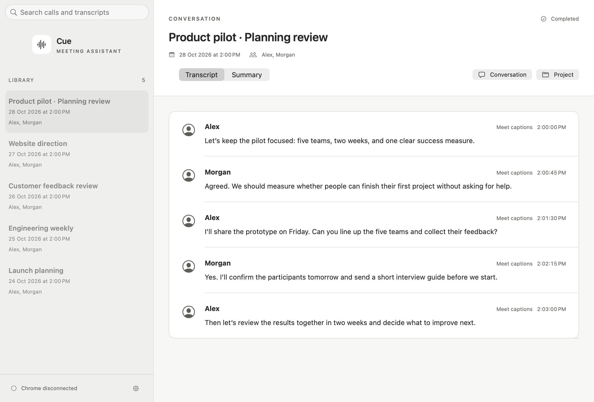
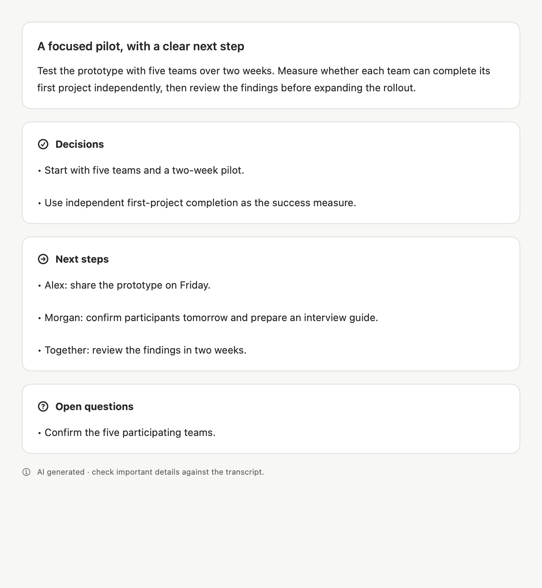
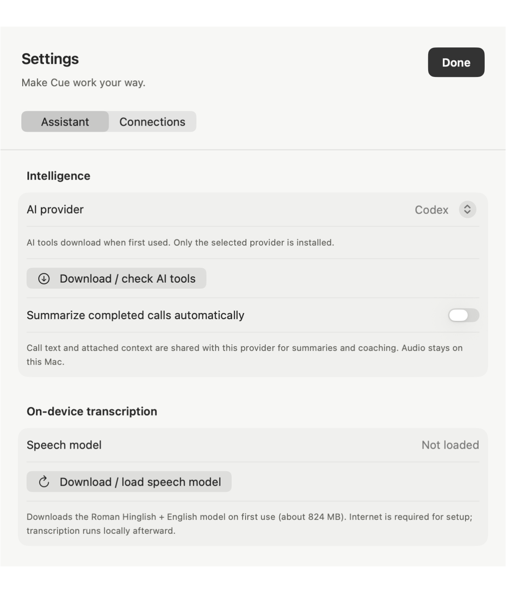

<p align="center">
  
</p>

<h1 align="center">Cue</h1>
<p align="center"><strong>Stay present. Leave with clarity.</strong></p>
<p align="center">A local-first macOS call assistant for Google Meet.<br>On-device transcripts, useful summaries, and a little guidance when you need it.</p>

<p align="center">
  <a href="LICENSE"></a>
  
  
</p>

<p align="center">
  <a href="#quickstart">Get started</a> ·
  <a href="docs/setup.md">Setup guide</a> ·
  <a href="docs/architecture.md">Architecture</a> ·
  <a href="CONTRIBUTING.md">Contribute</a>
</p>



<p align="center"><sub>Actual Cue interface, populated with synthetic demo conversations. No private call data is shown.</sub></p>

## From conversation to follow-through

Cue pairs a small Chrome extension with a native Mac app. The extension captures Google Meet captions and call audio; the app keeps a searchable local library, transcribes audio on your Mac, and helps you revisit decisions and next steps.

| During the call | After the call | Under your control |
| --- | --- | --- |
| Capture captions, microphone, and remote audio | Read speaker-labeled, source-linked transcripts | Keep audio and transcripts on your Mac |
| Receive optional Codex or Claude coaching | Review summaries, decisions, and action items | Choose your AI provider and attached context |
| Keep guidance in a compact floating panel | Group recurring meetings and share project context | Configure coaching translucency and visibility |

Transcription supports Roman Hinglish and English through WhisperKit. Optional Calendar access matches calls to scheduled meetings after macOS permission. Ambiguous speech stays **Unknown** rather than being assigned an unsupported speaker identity.

<table>
  <tr>
    <td width="55%" valign="top">
      <strong>Decisions and next steps</strong><br>
      <sub>Structured summaries keep actions and open questions easy to find.</sub><br><br>
      
    </td>
    <td width="45%" valign="top">
      <strong>Your tools, downloaded when needed</strong><br>
      <sub>Choose a provider, download its tools, and manage local transcription in Settings.</sub><br><br>
      
    </td>
  </tr>
</table>

## Quickstart

**Install:** Get the Apple Silicon DMG from [GitHub Releases](https://github.com/EXTREMOPHILARUM/cue/releases/latest). You’ll need macOS 14+, Google Chrome, and internet for initial downloads. Intel is not yet verified.

**Build from source:** You’ll additionally need Xcode Command Line Tools with Swift 5.10+ and Node.js 22+ with npm.

### 1. Build the app

```sh
git clone https://github.com/EXTREMOPHILARUM/cue.git
cd cue
scripts/build-dmg.sh
```

Open the disk image under `build/`, drag **Cue** into **Applications**, and launch it. The extension is included in both the app and the disk image.

> Local builds use ad-hoc signing by default. Published releases identify their Developer ID signing and notarization status in the release notes.

### 2. Connect Chrome

1. In Cue Settings, open **Connect Chrome** and prepare the extension.
2. Open `chrome://extensions`, enable **Developer mode**, and choose **Load unpacked**.
3. Select the persistent folder Cue reveals, then enter its extension ID in Cue.

Use the persistent folder, not the copy on the mounted disk image. Install or reload only outside a call. Chrome Web Store installation is not provided.

### 3. Let the local model get ready

Cue downloads its speech model on first launch—approximately **824 MB**—then prepares it for your Mac. Settings shows model status and provides a retry button.

Codex and Claude tools download independently when first used, or through **Download / check AI tools**. Only the selected provider is installed. Downloads are integrity-checked and cached outside the app; they are not bundled into the installer. AI features require a separately configured provider account.

For troubleshooting, cache locations, and optional checks, see the [setup guide](docs/setup.md).

## What stays local?

| Data or operation | Where it goes |
| --- | --- |
| Audio recording and transcription | Your Mac |
| Saved calls, transcripts, and browser offline queue | Local app/browser storage |
| Optional AI summaries and coaching | Call text and explicitly attached context go to your selected provider |
| Speech-model and provider-tool downloads | Their upstream download hosts |
| Calendar matching | Local EventKit access; calendar titles and times are not added to AI prompts |

The app’s bridge binds to `127.0.0.1:17373`. It checks the configured browser extension’s exact origin and trusts other local programs without authentication. Review the [security model](SECURITY.md) before using sensitive conversations or attaching project context. Follow applicable recording and participant-consent requirements.

## Know the limits

- Captions, transcripts, speaker attribution, and AI output can be wrong. Review important details against original sources.
- Meet changes can break capture; synthetic checks do not prove reliability across every real call or device.
- The coaching panel may appear during full-screen sharing.
- Initial downloads require internet access. Optional AI features depend on the selected provider’s account and service.

## Develop with Cue

Run the canvas, extension, packaging, native tests, and dependency audit:

```sh
scripts/verify-native.sh
```

Real audio fixtures and signed-in provider checks are opt-in. Use disposable browser profiles for integration tests. Keep recordings, databases, transcripts, credentials, and private screenshots outside Git.

With Cue running, inspect local calls through the CLI:

```sh
node scripts/cue.mjs status
node scripts/cue.mjs list
node scripts/cue.mjs read --session SESSION_ID --after 0
```

See [architecture](docs/architecture.md), [contributing](CONTRIBUTING.md), and [screenshot reproduction](docs/screenshots/README.md).

## License

Cue’s original code is [MIT licensed](LICENSE). Adapted capture/protocol code retains its Apache-2.0 licensing and attribution; see [NOTICE](NOTICE) and `docs/licenses/`. Downloaded dependencies and model weights retain their upstream licenses.
